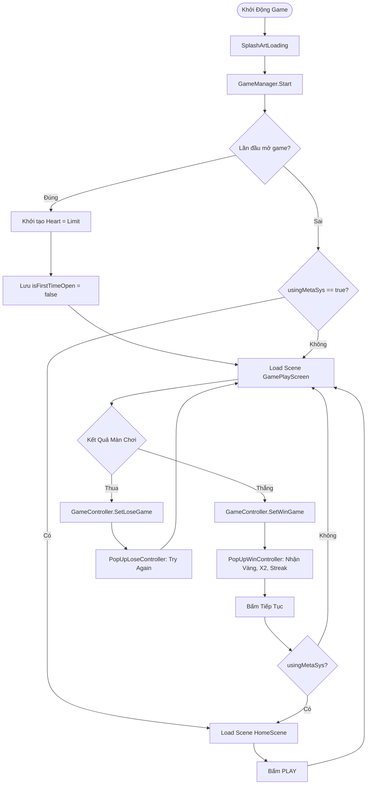
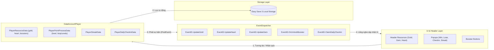
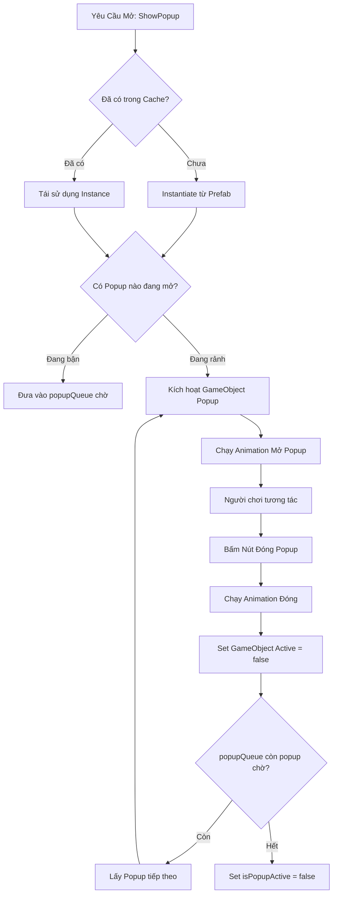

# TÀI LIỆU TỔNG QUAN KIẾN TRÚC & TÍNH NĂNG BASE CODE (SPINOLAB)

Tài liệu này tổng hợp toàn bộ cấu trúc dự án, mô hình kiến trúc, các hệ thống tính năng có sẵn và hướng dẫn mở rộng cho dự án **SpinoLab-Base-Code**.

---

## I. THÔNG TIN CHUNG & CÔNG NGHỆ (TECH STACK)

- **Engine**: Unity (C# .NET Standard)
- **Thư viện bên thứ ba (Third-Party Plugins)**:
  - **Sirenix Odin Inspector**: Tối ưu hóa Custom Inspector, Attributes, Serialization.
  - **Easy Save 3 (ES3)**: Lưu trữ và mã hóa dữ liệu cục bộ người chơi (Save/Load nhanh, an toàn).
  - **LitMotion**: Thư viện Tweening hiệu năng cao (Zero-allocation) dùng cho toàn bộ animation UI và số nhảy.
  - **Feel (MoreMountains MMFeedbacks / MMTools)**: Hỗ trợ hiệu ứng rung haptic và animation phản hồi.
  - **Lofelt NiceVibrations**: Hỗ trợ chuẩn rung Haptic đa nền tảng (iOS / Android).
  - **Google Sheets For Unity (NorskaLib)**: Đồng bộ hóa dữ liệu từ Google Sheets về ScriptableObject trong Unity Editor.
  - **UniRx & Demigiant DOTween Pro**: Xử lý reactive và tween mở rộng.

---

## II. KIẾN TRÚC PHÂN TẦNG (ARCHITECTURE LAYERS)

Dự án được cấu trúc theo 4 tầng chính:

```
+-------------------------------------------------------------------------+
|                        1. PRESENTATION & UI LAYER                       |
|  - Scenes: SplashArtLoading, LoadingScene, HomeScene, GamePlayScreen    |
|  - UI Controllers: UIGameController, HomeUIManager, HeaderUIController  |
|  - Popup System: PopupManager, PopupBaseController (Queue tuần tự)     |
|  - FeatureUI Effects: Loop (vô hạn) & OneTime (Squash/Stretch, Punch)   |
+-------------------------------------------------------------------------+
                                    |
                                    v
+-------------------------------------------------------------------------+
|                     2. GAMEPLAY & FEATURE CONTROLLERS                   |
|  - GameManager: Singleton điều phối Scene & FrameRate                   |
|  - GameController: Quản lý trận đấu, Onboarding, Win/Lose, Level Loop   |
|  - Feature Managers: BoosterManager, DailyStreakService, TutorialManager|
|  - SpecialOfferAdsService: Kích hoạt ưu đãi xem Ads nhận booster        |
+-------------------------------------------------------------------------+
                                    |
                                    v
+-------------------------------------------------------------------------+
|                     3. DATA & PERSISTENCE LAYER                         |
|  - DataAccountPlayer (Static Facade): Quản lý PlayerData qua ES3        |
|  - PlayerData Models: Resource, PointProcess, Streak, Checkin, Piggy    |
|  - LoadResourceController: Singleton nạp Data/Configs từ Resources/data  |
|  - ScriptableObjects (NorskaLib): DataHeart, DataBooster, DataReward... |
+-------------------------------------------------------------------------+
                                    |
                                    v
+-------------------------------------------------------------------------+
|                     4. CORE INFRASTRUCTURE & SERVICES                   |
|  - EventDispatcher: Cơ chế Pub/Sub qua EventID (Decoupled hoàn toàn)   |
|  - SmartPool & FactoryDesignPattern: Tối ưu bộ nhớ, tái sử dụng Object  |
|  - Services: AdsManager, AnalyticManager, SoundManager, HapticManager   |
|  - Notification: AndroidNotificationManager (Local Push Notification)   |
+-------------------------------------------------------------------------+
```

---

## III. DANH MỤC CHI TIẾT CÁC HỆ THỐNG TÍNH NĂNG

### 1. Quản Lý Vòng Đời & Điều Hướng Scene
- **Scripts chính**: `Base.Core.GameManager`, `UI.LoadingScene.LoadingScene`, `UI.LoadingScene.SceneName`.
- **4 Scenes**:
  - `SplashArtLoading`: Màn khởi động đầu tiên.
  - `LoadingScene`: Nạp scene bất đồng bộ với thanh tiến trình.
  - `HomeScene`: Sảnh chính (Meta System) chứa bảng xếp hạng, heo đất, điểm danh, shop.
  - `GamePlayScreen`: Màn hình gameplay chính.
- **GameConfig (`Data/GameConfig.asset`)**:
  - `usingMetaSys` (bool): Bật/tắt sảnh HomeScene. Nếu false, game chạy thẳng vào Gameplay.
  - `levelUnlockMetaSystem` (int): Cột mốc level để mở khóa HomeScene.
  - `usingResourceInGame` (bool): Bật/tắt thanh tài nguyên trong GamePlay.
  - `usingHeart` / `usingGem` (bool): Bật/tắt hệ thống Tim và Kim cương.
  - `levelRandom` / `levelMin` (int): Cấu hình vòng lặp màn chơi ngẫu nhiên.

### 2. Gameplay & Quản Lý Màn Chơi (Level Loop)
- **Scripts chính**: `GameController`, `UIGameController`, `HeaderUIController`, `MapManager`.
- **Level Flow**:
  - Khi bắt đầu: Tự động tải prefab `Resources/Level/Level{id}.prefab` theo `PlayerPointProcessData.currentlevel`.
  - Level Loop: Khi vượt qua mốc `levelRandom`, game sẽ tự động xáo trộn và chọn ngẫu nhiên các level trong khoảng `[levelMin, levelRandom]` sao cho không trùng lặp các level vừa chơi (`listLvLoop`).
  - Hard Level: Tự động kích hoạt cảnh báo màn khó (`SetWarningHardLevel`) tại các màn cấu hình (mặc định màn 5, 6).

### 3. Hệ Thống Tim / Năng Lượng (Heart Recovery System)
- **Scripts chính**: `HeartResourcesHeader`, `DataHeartController`, `PlayerResourceData`.
- **Cơ chế vận hành**:
  - Lần đầu mở game: Tự động gán `heart = limit` (lấy từ `DataHeart.asset`, mặc định 5 tim).
  - Tiêu hao / Bù giờ: Khi `heart < limit`, đồng hồ tự động đếm ngược theo chu kỳ (mặc định 600 giây = 10 phút / tim).
  - **Offline Recovery**: Sử dụng Unix Timestamp (`lastHeartRecoveryTime`). Khi người chơi thoát game hoàn toàn hoặc pause ứng dụng rồi quay lại, hệ thống tính toán chính xác số tim được bù và giữ lại số giây lẻ cho chu kỳ tiếp theo, không làm mất thời gian của người chơi.
  - Hiển thị: Trên `timeCountTxt`, nếu tim đầy hiển thị chữ `"full"`, nếu đang hồi hiển thị định dạng `mm:ss` (hoặc `hh:mm:ss`).

### 4. Hệ Thống Booster In-Game
- **Scripts chính**: `BoosterManager`, `BoosterButtonController`, `BoosterType`, `DataBoosterController`, `PopupBoosterUnlockController`.
- **Cơ chế**:
  - Hỗ trợ 4 loại: `Booster1`, `Booster2`, `Booster3`, `Booster4`.
  - Tự động sinh danh sách nút Booster từ cấu hình Google Sheet `DataBooster.asset`.
  - Mở khóa: Khi người chơi đạt level quy định và chưa có booster, tự động hiển thị `PopupBoosterUnlockController`.
  - Hiệu ứng: Tích hợp `SpawnCircleEffectUI` tạo hiệu ứng bay tỏa item từ vị trí unlock vào nút bấm.

### 5. Hệ Thống Điểm Danh 7 Ngày (Daily Check-in)
- **Scripts chính**: `PopupDailyCheckinController`, `DailyCheckinElements`, `PlayerDailyCheckinData`.
- **Cơ chế**:
  - Chu kỳ 7 ngày với danh sách quà tăng dần từ `DataRewardPopup.asset`.
  - Đếm ngược 24 giờ kể từ mốc điểm danh gần nhất (dựa trên UTC time).
  - Hỗ trợ nhận quà thường và nút Claim x2 qua Reward Ads.

### 6. Hệ Thống Chuỗi Chiến Thắng (Daily Streak)
- **Scripts chính**: `DailyStreakService`, `PopupDailyStreakController`, `ItemDailyStreak`, `PlayerStreakData`, `DataDailyStreak`.
- **Cơ chế**:
  - Ghi nhận mỗi khi người chơi thắng màn (`DailyStreakService.OnLevelWon()`).
  - Tự động hiển thị popup tiến độ Streak trước khi bước vào màn tiếp theo.
  - Hỗ trợ cấu hình mốc thưởng streak và reset streak khi sang ngày mới hoặc đứt chuỗi.

### 7. Hệ Thống Giới Thiệu Cơ Chế Mới & Hướng Dẫn (Onboarding & Tutorial)
- **Scripts chính**: `PopupProcessUnlockMechanicController`, `TutorialManager`, `HandMoveTutorial`, `HandSingleTutorial`, `DataProcessMechanic`, `DataTutorialController`.
- **Cơ chế**:
  - Mechanic Unlock: Giới thiệu cơ chế mới theo từng màn chơi với ảnh minh họa tự động link từ `Assets/Texture/UI/MechanicUnlock/Mech_{id}.png`.
  - Tutorial: Sinh bàn tay ảo chỉ dẫn tương tác dạng trượt (`TUTORIAL_HAND_SLIDE`) hoặc click chạm (`TUTORIAL_HAND`) qua `FactoryDesignPattern`. Tự động ẩn khi hoàn thành bước (`EventID.FinishTutorialStep`).

### 8. Hệ Thống Heo Đất (Piggy Bank)
- **Scripts chính**: `PiggyBankController`, `PiggiBankGemController`, `PiggiBankGoldController`, `DataPiggyBankController`, `PlayerPiggyBank`.
- **Cơ chế**:
  - Gồm 2 loại heo: Heo Vàng (`PiggyGold`) và Heo Kim Cương (`PiggyGem`).
  - Sau mỗi trận thắng, tích lũy tài nguyên vào heo cho tới khi đạt `max_value`.
  - Popup cho phép người chơi mua để đập heo nhận toàn bộ tài nguyên tích lũy với giá ưu đãi.

### 9. Hệ Thống Thắng / Thua & Nhận Thưởng (Win / Lose & Reward Gauge)
- **Scripts chính**: `PopUpWinController`, `PopUpLoseController`, `RewardGaugeController`, `CoinRewardFlyEffect`, `PopupShowReward`.
- **Cơ chế**:
  - Thắng: Bắn pháo hoa ăn mừng (`confetiStartWin`, `confetiRainWin`), bật âm thanh chiến thắng, mở popup win.
  - Kim đo may mắn (`RewardGaugeController`): Cho phép người chơi căn điểm dừng để nhận hệ số nhân vàng x2, x3, x5 qua Ads.
  - Popup nhận quà đa năng (`PopupShowReward`): Hiển thị danh sách card quà tặng lật mở và gom quà bay vào Header.

### 10. Hệ Thống Bảng Xếp Hạng (Ranking Leaderboard)
- **Scripts chính**: `RankingController`, `RankingElement`, `DataRankingController`.
- **Cơ chế**:
  - Bảng xếp hạng offline từ dữ liệu `DataRanking.asset`.
  - Hiển thị thứ hạng, cờ quốc gia, avatar, tên và điểm số, đánh dấu vị trí của người chơi trong giải đấu.

### 11. Hệ Thống Ưu Đãi Quảng Cáo (Special Offer Ads)
- **Scripts chính**: `SpecialOfferAdsService`, `PopupSpecialOfferAds`, `SpecialOfferAds`, `PlayerSpecialOfferAdsData`.
- **Cơ chế**:
  - Ghi nhận khi người chơi hết sạch booster nhưng vẫn cố tình bấm sử dụng.
  - Khi tích đủ điểm bấm và đạt số trận thắng tối thiểu sau khi unlock booster, game tự động kích hoạt popup xem 1 video quảng cáo để nhận miễn phí booster.

### 12. Hệ Thống IAP & Gói No-Ads
- **Scripts chính**: `BaseBundlePurchaseController`, `BundlePurchasePack1Controller`, `GroupBundlePackGoldController`, `PlayerResourceData`.
- **Cơ chế**:
  - Hỗ trợ gói No-Ads vĩnh viễn (`isNoAdsPurchase`).
  - Hỗ trợ gói No-Ads 24 giờ (`isNoAdsPurchase24h`) có hàm kiểm tra hiệu lực thời gian thực `IsNoAds24StillActive()`.
  - Tự động điều chỉnh layout UI chân trang (`footerArea`) khi có hoặc không có quảng cáo Banner.

### 13. Hệ Thống Quản Lý Popup Hàng Đợi (Popup Manager Queue)
- **Scripts chính**: `PopupManager`, `PopupBaseController`.
- **Cơ chế**:
  - Quản lý tập trung các popup qua `popupQueue`. Khi gọi mở nhiều popup liên tiếp, game sẽ hiển thị tuần tự từng popup, tránh đè chồng lên nhau.
  - Tự động cache instance để không phải Instantiate nhiều lần.
  - Hỗ trợ `ModuleShowReward`: ưu tiên đưa popup nhận quà xuống cuối cùng trong Canvas để đè lên tất cả các popup khác.

### 14. Bộ Hiệu Ứng Giao Diện UI (FeatureUI)
- **Scripts chính**: `Assets/Scripts/Controller/FeatureUI/` (xây dựng hoàn toàn trên LitMotion zero-alloc).
- **Nhóm Loop (Lặp vô hạn)**:
  - `BreathScaleEffectUI`: Co giãn nhịp thở.
  - `BreathAlphaEffectUI`: Nhấp nháy độ trong suốt.
  - `FloatingEffectUI`: Lơ lửng bồng bềnh.
  - `RotateEffectUI`: Xoay tròn liên tục.
  - `RotatePingPongEffectUI`: Lắc qua lắc lại hình quả lắc.
- **Nhóm OneTime (Diễn 1 lần)**:
  - `ScaleEffectSquashAndStretch`: Hiệu ứng phồng xẹp theo đường cong X/Y độc lập.
  - `ButtonScaleEffectUI`: Nảy nút khi bấm.
  - `PunchEffectUI`: Hiệu ứng đập nảy.
  - `RandomShakerUI`: Rung lắc ngẫu nhiên (chấn động).
  - `FadeEffectUI`, `MovingEffectUI`, `MoveToTargetEffectUI`.

### 15. Dịch Vụ Nền Tảng (Services & Audio/Haptics)
- **`AdsManager`**: Hook sẵn các hàm gọi quảng cáo Interstitial, Rewarded, Banner, App Open Ads (AOA).
- **`AnalyticManager`**: Ghi nhận toàn bộ sự kiện phễu người chơi (`LevelStart`, `LevelComplete`, `LevelFailed`, `TryAgain`, `BoosterUsing`, `TutorialStep`).
- **`SoundManager`**: Quản lý âm thanh BGM và SFX thông qua `SoundType`, đồng bộ theo `PlayerSettings`.
- **`HapticManager`**: Tích hợp rung phản hồi (Success, Failure, Warning, LightImpact, Selection) qua Lofelt NiceVibrations.
- **`AndroidNotificationManager`**: Hẹn giờ bắn Notification cục bộ (Local Push Notification) theo `NotificationSettings.asset`.

### 16. Công Cụ Debug, Cheat & Marketing (Admin Panel)
- **Script chính**: `AdminController`.
- **Tính năng**:
  - Thắng nhanh (`btnWin`), Thua nhanh (`btnLose`), Nhảy tới level bất kỳ (`inputLevel`).
  - Mở khóa tất cả Booster, cộng 10 booster mỗi loại.
  - Cheat ngày của Daily Streak (`inputDayStreak`, `btnFinishStreak`).
  - Chế độ quay Marketing Video: Tắt toàn bộ UI game, bật/tắt bàn tay ảo tự động trượt/chạm.

---

## IV. CÁC SƠ ĐỒ HỆ THỐNG (SYSTEM DIAGRAMS)

### 1. Sơ Đồ Vòng Đời & Luồng Chuyển Scene



### 2. Sơ Đồ Dữ Liệu & Event Dispatcher (Pub/Sub)



### 3. Sơ Đồ Cơ Chế Hàng Đợi Popup (`PopupManager`)



---

## V. HƯỚNG DẪN MỞ RỘNG & PHÁT TRIỂN TIẾP (EXTENDING THE CODEBASE)

1. **Cách mở popup bất kỳ**:
   ```csharp
   PopupManager.Instance.ShowPopup<PopupDailyCheckinController>();
   ```
2. **Cách mở popup nhận thưởng đa năng**:
   ```csharp
   List<PopupReward> rewards = new List<PopupReward>()
   {
       new PopupReward { typeReward = TypeResources.gold, value = 500 },
       new PopupReward { typeReward = TypeResources.diamond, value = 10 }
   };
   PopupManager.Instance.ModuleShowReward().OpenPopup(rewards);
   ```
3. **Cách thay đổi và lắng nghe tài nguyên (Gold/Heart/Gem)**:
   ```csharp
   // Cộng trừ tim
   DataAccountPlayer.PlayerResourceData.AddHeart(1);
   DataAccountPlayer.PlayerResourceData.SubtractHeart(1);

   // Lắng nghe sự kiện UI
   this.RegisterListener(EventID.UpdateHeart, (sender, param) => {
       // Cập nhật giao diện
   });
   ```
4. **Cách thêm một hiệu ứng OneTime / Loop vào UI**:
   - Gắn component hiệu ứng tương ứng (`ScaleEffectSquashAndStretch`, `BreathScaleEffectUI`...) vào GameObject UI cần diễn.
   - Bật tick `CanPlayWhenEnable = true` để hiệu ứng tự động reset về trạng thái ban đầu và diễn ngay khi popup hiển thị.
